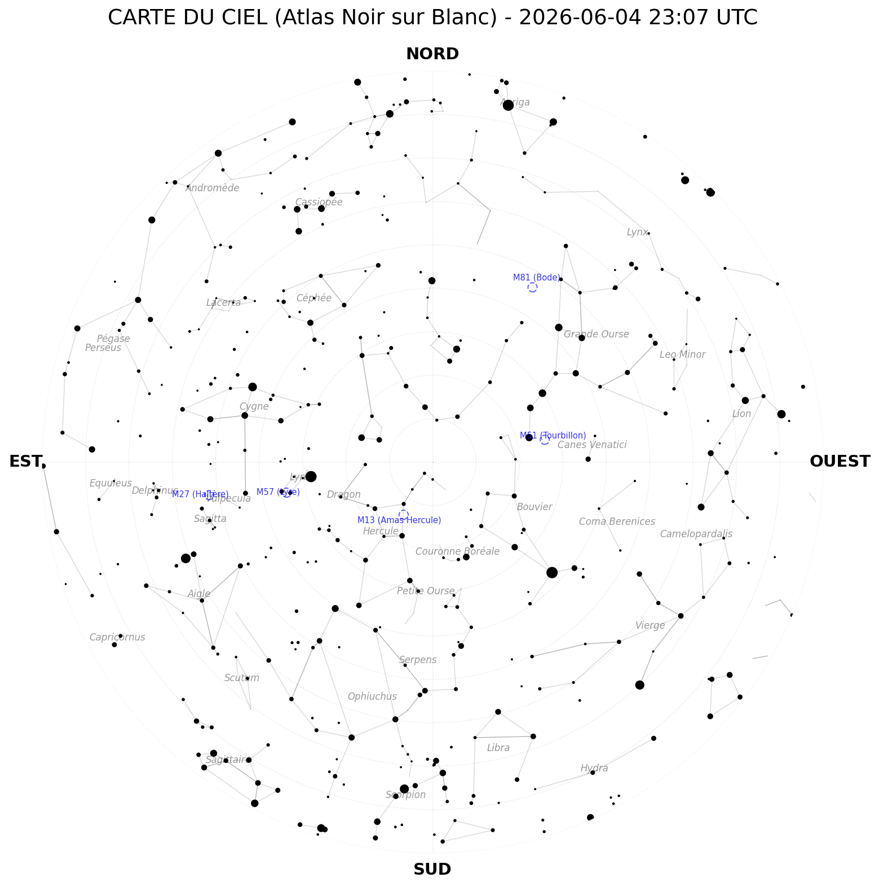

# Night Sky Generator

A Python project to generate realistic night sky maps.

## Preview



## Installation

1. Create a virtual environment:
   ```bash
   python -m venv venv
   source venv/bin/activate  # On Windows: venv\Scripts\activate
   ```

2. Install dependencies:
   ```bash
   pip install -r requirements.txt
   ```

## Usage

Run the main script to generate a new night sky:
```bash
python generate_sky.py
```

## Files

- `generate_sky.py`: Main generation script.
- `night_sky.png`: Latest generated sky map.
- `constellations.json`, `constellations.npz`, `constellationship.fab`: Constellation data.
- `hip_main.dat`: Star catalog data.
- `de421.bsp`: Ephemeris data for celestial bodies.
